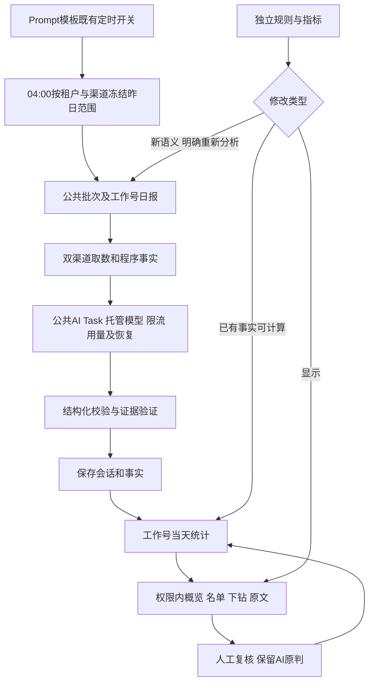
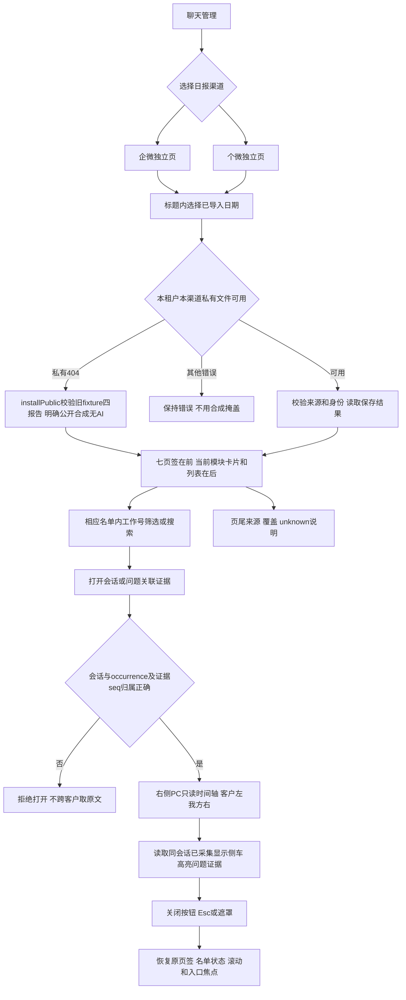
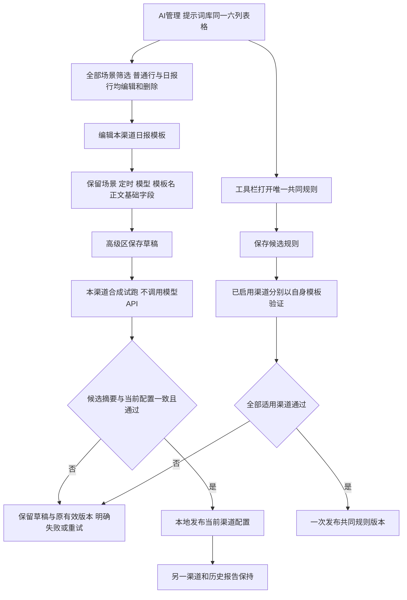
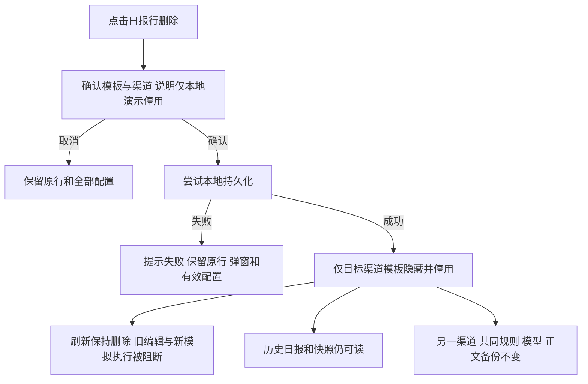
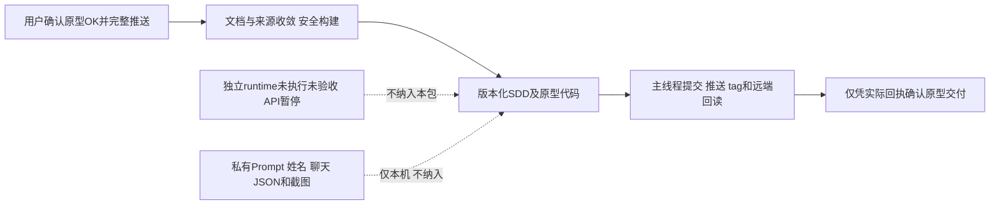

# 会话质检日报工程候选流程

本轮用户已授权实施，源资料正式合入待审。行为定义见[092@0.4.0](../docs/sdd/SPEC-SUIYIN-ADMIN-092/0.4.0/spec.md)。

失败补跑保留原批次范围，成功会话不重复外呼；显示调整不触发模型。统计结果一致发布，未知和缺口单列；08:00完成须真实规模验证。生产数据删除、部署及对外发送不在本轮授权内。

## 0.3.3历史流程

以下是原静态原型流程，保留历史证据，不作为新版高级设置或深圳限制的依据。

# 会话质检日报交互流程

行为真源：[092@0.3.3](../docs/sdd/SPEC-SUIYIN-ADMIN-092/0.3.3/spec.md)。用户已批准当前静态原型并要求完整推送；下图表示已实现的本机阅读及配置演示，API暂停，运行合同不纳入本次交付。

## 独立渠道与报告阅读

当前真实版无顶部综合过滤器／右上折叠筛选，不提供运行或重跑按钮；生成时间来自保存的分析时间。抽屉只显示有来源的头像、昵称、时间和发送元信息，缺失unknown；转写与原音频分开，无音频不显示播放。无发送、转发或撤回动作。显示侧车扩充已采集记录，不重算报告或改变证据身份。

## 提示词编辑与共同规则

编辑取消不改变已发布配置；未保存离开需保存／放弃／继续。旧模板维持原CRUD和实采字段。模型页为企业只读目录，绑定候选必须启用且支持当前场景，默认解析失败时不静默替换。标签、分组子提示词及原场景定时说明按本租户来源呈现；未采集与确认空选项分开。

## 日报模板本地删除

没有线上删除请求、物理清除私有输入或新增恢复／重建入口。Chrome验证同表操作、编辑取消、删除弹窗和取消；成功删除、失败、刷新、幂等与隔离在实际模块的jsdom／VM中验证，不改用户浏览器存储。

## 静态交付与后续功能

后续真实功能仍按独立合同先跑通企微和个微调用／校验／持久化闭环，再验证04:00至08:00；静态与Codex离线结果不能替代API、生产或容量验收。旧过程版流程及0.3.x回执只作历史，当前规则以本版本及[来源收敛账本](../docs/sdd/SPEC-SUIYIN-ADMIN-092/0.3.3/source-convergence.md)为准。

2026-10-30后续已批准实施增补：[日报可靠性与运营操作调整](../docs/sdd/SPEC-SUIYIN-ADMIN-092/0.4.0/operator-corrections-20261030.md)。本轮详细Plan/AC和接口增量以此为准；历史合同仅按明确保留范围适用。

### 2026-10-31 运营工作流已批准增补

用户已确认[运营配置、两个日报页及状态收敛Plan／六条AC](../docs/sdd/SPEC-SUIYIN-ADMIN-092/0.4.0/operator-workflow-20261031.md)及随附可点击合成原型，进入实现；源仓正式审阅仍待审，部署、付费分析和恢复定时另行授权。沿0.4.0最小增补，不更换原型站Shell；当前补充中的普通手动准入与分析版本边界优先于旧文中相反说明。
