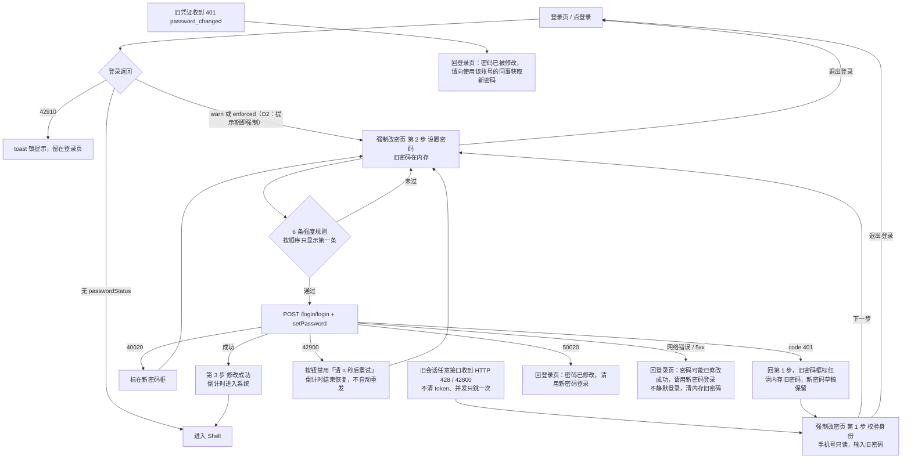
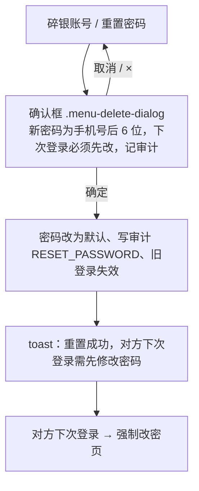

# 弱口令强制改密交互流程（管理后台）

合同：[WEAK-PASSWORD-4746@0.1.0](../docs/sdd/SPEC-SUIYIN-ADMIN-WEAK-PASSWORD-4746/0.1.0/spec.md)。产品说明见 [weak-password.md](../prd/weak-password.md)。

原型的服务端返回由 URL 参数模拟（见产品说明「演示入口」），不接真实接口。
